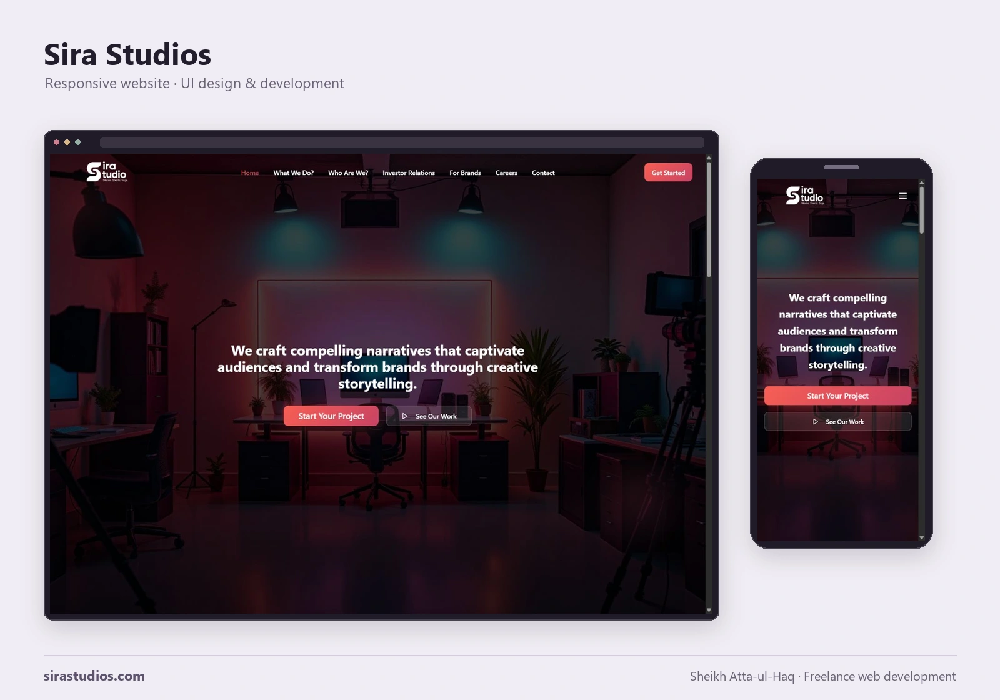

# Sira Studios website

A freelance web development project for a creative production studio, built with React, TypeScript and a PHP/MySQL backend for enquiries, career applications and account access. This repository includes the code, website assets and design documentation.



[Design notes and screenshots](docs/design-notes.md) · [PHP configuration](api/README.md) · [Database setup](database/README.md)

## Website

Public pages cover the studio, services, brand work, investor relations, careers and contact. The home page combines a photographic studio hero, project calls to action, animated counters and a creative-work carousel.

Contact and career forms validate input and submit to PHP endpoints. Account pages support registration and login; the backend checks database roles before exposing contact or career submissions through the admin API.

The stack uses Vite, Tailwind CSS, Radix-based UI components, React Router and PHP with PDO MySQL.

## Local setup

Use Node.js 22 and npm:

```sh
npm ci
npm run dev -- --host 127.0.0.1
```

The Vite frontend runs on port 8080. A production preview uses:

```sh
npm run build
npm run preview -- --host 127.0.0.1
```

## PHP API and deployment

Review [PHP configuration](api/README.md) and [database setup](database/README.md) before enabling backend features. Set the database environment values, a private `JWT_SECRET` of at least 32 characters, and `SIRA_RATE_LIMIT_DIR` pointing to an existing private directory outside every web-served directory.

The client defaults to same-origin `/api`. Vite does not execute PHP or configure an API proxy. Map `/api` to the local PHP backend through a web server or development proxy. `VITE_API_BASE_URL` can select another API base; a separate origin also requires an explicitly permitted origin in the PHP CORS configuration.

Deploy the contents of `dist/` as the frontend and deploy the repository's `api/` directory separately at `/api`; Vite does not copy that directory into `dist/`. Configure SPA fallback for public routes. Keep database SQL, credentials and rate-limit counters outside public paths.

The shared limiter enforces action/IP quotas and a normalized account quota for login. Unavailable or corrupted private storage fails closed. Its file locks require one host or a filesystem with reliable shared locking.

## Verification

```sh
npm run typecheck
npm run build
npm audit --audit-level=high
find api tests -type f -name '*.php' -exec php -l {} \;
php tests/test_rate_limit.php
```

The offline PHP suite checks quotas across fresh processes, concurrent requests, account normalization, window boundaries and storage failures without a database or live API. See [the backend instructions](api/README.md) for temporary-directory configuration.

[The verification workflow](.github/workflows/verify.yml) runs the frontend and PHP checks and scans source plus Git history with the official checksum-verified Gitleaks binary.

## Source map

- `src/pages/` — public, account and admin interfaces.
- `src/lib/api.ts` — API calls and browser token handling.
- `src/index.css` and `tailwind.config.ts` — colors, gradients and motion utilities.
- `api/` and `database/` — backend endpoints and database schema.
- `docs/images/` — desktop and mobile screenshots.

Brand assets and third-party dependencies retain their respective ownership and license terms.

