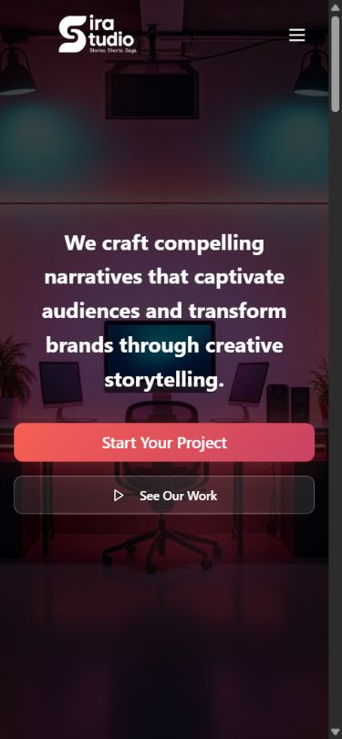

# Design notes

## Visual direction

Sira pairs a dark photographic studio hero with white text and coral-to-magenta calls to action. Interior sections use a white canvas, near-black text, muted surfaces and purple accents. Gradient buttons, soft glow effects and rounded cards carry the same visual vocabulary across public and account pages.

The color stops, radius, shadows and animation utilities are defined in `src/index.css`; Tailwind maps those tokens to components. The implementation uses its sans-serif font stack with bold headings.

## Layout and interaction

The home page places the project and work calls to action over the studio image, followed by animated counters and an image carousel. Services, studio information, brand work, investor relations, careers and contact are separate routes with shared navigation and footer.

Navigation collapses to a menu button on smaller screens. Hero actions stack vertically on mobile, and the work cards adapt their visible column count by breakpoint. Slide, scale and hover treatments come from the CSS utility layer; the carousel uses the shared UI carousel component.

Contact and careers forms show validation and submission feedback. Account and admin interfaces reuse the same form and card components; protected data remains subject to PHP authorization checks.

## Repository screenshots

| View | Image |
| --- | --- |
| Home, desktop | [Open screenshot](images/home-desktop.png) |
| Home, mobile | [Open screenshot](images/home-mobile.png) |
| Services, desktop | [Open screenshot](images/services-desktop.png) |
| Desktop and mobile presentation | [Open presentation](images/devices.webp) |

## Metadata

`index.html` defines the site title, description, author, keyword metadata, Open Graph and Twitter title/description fields, social-image references and a favicon. `public/robots.txt` permits crawlers. The current metadata is defined at the application shell.

## Maintaining the design

Preserve readable text contrast over photography and keep gradient accents consistent with the token definitions. Review mobile CTA wrapping, menu focus and form errors when changing components. Check image alternative text and animation preferences when extending motion.

